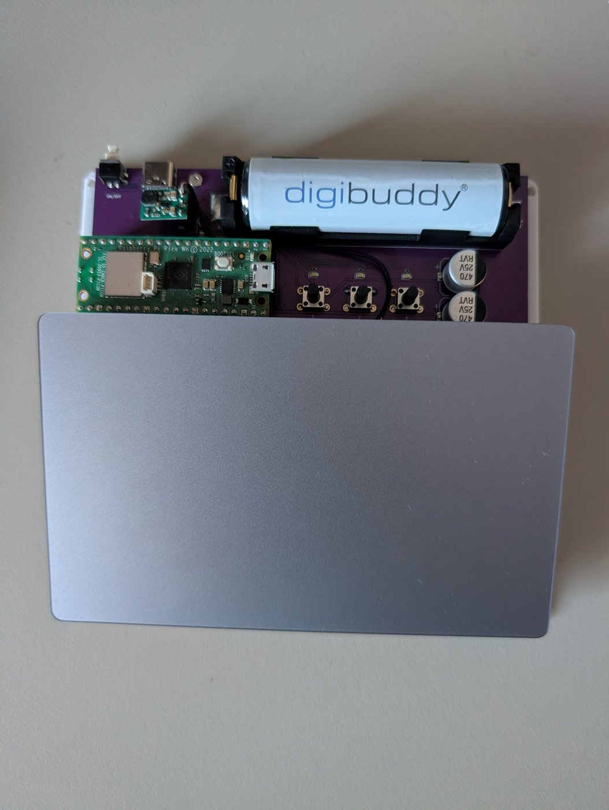
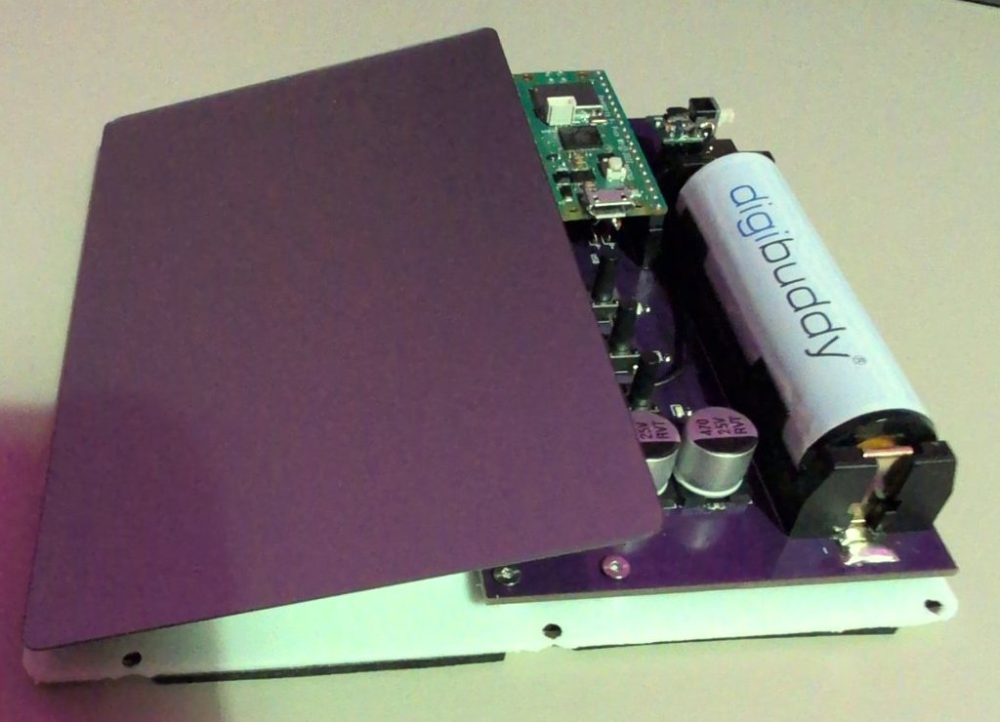

# Trackpad A1708 senza fili

**Trasforma il trackpad Force Touch di un MacBook Pro (A1708, 13" 2016–2017) in un trackpad
indipendente USB / Bluetooth, con i gesti 1:1 come su Mac.**

*[Read in English](README.md)*

<p align="center">
  
  
</p>

Un Raspberry Pi Pico W parla col trackpad nel suo protocollo SPI originale e lo presenta al
computer come **Windows Precision Touchpad** (PTP), via USB, Bluetooth classico o Bluetooth Low
Energy. Windows lo supporta da solo. Su macOS, che non supporta i touchpad PTP di altri produttori, una piccola app nella
barra dei menu ([macos-trackpad-companion](https://github.com/mathias-sm/macos-trackpad-companion),
modificata per questo progetto) trasforma i tocchi in veri gesti di macOS: cambio scrivania,
Mission Control, zoom, rotazione e scorrimento fluido che seguono le dita 1:1.

## Cosa fa

- **Hardware Apple originale**: stesso vetro, stesso clic Force Touch con la vibrazione, generata
  dal trackpad stesso.
- **Tre collegamenti**: cavo USB-C, Bluetooth classico o **Bluetooth Low Energy** con il servizio
  Batteria standard, per vedere la carica nel widget batteria di macOS e nelle impostazioni di
  Windows.
- **Tre computer abbinati**, si passa dall'uno all'altro con un tasto (come Logitech Easy-Switch),
  ognuno con il suo LED bianco.
- **Batteria 18650** con ricarica USB-C, pulsante di accensione, livello batteria sui LED,
  risparmio energetico e riposo automatico.
- **Sensazione da Mac**: la modifica dell'app usa le *stesse* curve di accelerazione di puntatore
  e scorrimento del trackpad integrato di un MacBook, lette da macOS.
- **Firmware robusto**: controlli dei messaggi come nel driver Linux `applespi`, filtro degli
  errori che il trackpad produce mentre vibra, clic senza rimbalzi.
- **Aggiornamento del firmware dalla USB-C** a scocca chiusa: tasti 1 e 3 premuti mentre colleghi
  il cavo.
- **Scheda unica** (KiCad, pronta per il montaggio da JLCPCB) e **scocca a cuneo** da stampare in 3D.

## Come funziona

```
 Trackpad A1708 ──SPI (4 MHz) + 3,3 V / 5 V / 12 V──▶  scheda unica
                                                         ├─ Raspberry Pi Pico W (firmware)
                                                         ├─ ricarica TP4056 + batteria 18650
                                                         ├─ convertitore MT3608 5 V
                                                         └─ convertitore Pololu U3V16F12 12 V (vibrazione)
        │
        ├─ USB HID ─────────────┐
        ├─ Bluetooth classico ──┼──▶ Windows: Precision Touchpad nativo
        └─ Bluetooth LE (HOGP) ─┘    macOS:  app Trackpad Companion ──▶ gesti nativi
```

## Cartelle

| Cartella | Contenuto |
|---|---|
| [`firmware/`](firmware) | Firmware del Pico W (C, pico-sdk, TinyUSB, BTstack) e file `.uf2` pronti |
| [`hardware/pcb/`](hardware/pcb) | Scheda KiCad, Gerber, BOM e posizioni per JLCPCB |
| [`hardware/case/`](hardware/case) | File STL della scocca e il loro sorgente Python |
| [`macos-companion/`](macos-companion) | Modifica per macos-trackpad-companion e script per compilarla |
| [`docs/`](docs) | Guida hardware, manuale del firmware, macOS, protocollo SPI |

## Da dove partire

1. **Leggi la [guida hardware](docs/it/hardware.md)**: elenco pezzi, ordine della scheda e le due
   piccole modifiche a mano che servono sulla scheda attuale.
2. **Carica il firmware**: copia `firmware/prebuilt/trackpad-a1708_pico_w.uf2` sul Pico W
   ([manuale del firmware](docs/it/firmware.md)).
3. **Stampa e monta la scocca** ([guida al montaggio](docs/it/assembly.md)).
4. **Abbinalo**: tieni premuto il tasto 1 per 3 secondi e cerca "Trackpad A1708" nelle impostazioni
   Bluetooth.
5. **Su Mac** compila e installa l'app ([guida macOS](docs/it/macos.md)).

Documentazione: [hardware](docs/it/hardware.md) · [montaggio](docs/it/assembly.md) ·
[firmware](docs/it/firmware.md) · [macOS](docs/it/macos.md) · [protocollo SPI](docs/it/protocol.md)

## Stato e limiti noti

È un progetto personale funzionante, condiviso così com'è. Da sapere:

- **La scheda v2 richiede due modifiche a mano**: un filo che alimenta il convertitore 12 V dalla
  batteria invece che dai 5 V (senza, i clic sono inaffidabili) e due fili per i dati USB. Sono
  spiegate con le foto nella guida hardware.
- **Autonomia**: circa 20 ore di uso continuo e circa 30 ore acceso ma fermo con una batteria da
  3000 mAh (misurati: ~86 mA in uso, ~49 mA fermo, ~38 mA a riposo, a 5 V). Il grosso lo
  consumano il Pico W e la sua radio: quando hai finito spegnilo col pulsante.
- **Provato su**: macOS 27 (USB, Bluetooth classico, BLE) e Windows (USB e Bluetooth classico).
  Il BLE su Windows dovrebbe funzionare ma non è ancora stato provato.
- **Pico W (RP2040)** è la scheda provata. C'è anche il firmware per il Pico 2 W, ma l'ultima
  versione non è stata provata lì.
- Su macOS "Scuoti il puntatore per individuarlo" non si attiva, perché il puntatore lo muove l'app
  con eventi sintetici.
- Gli identificativi USB sono la coppia di test pid.codes `1209:0001`, va bene per uso personale.
  Se costruisci e distribuisci dispositivi, prendine uno tuo.
- I commenti nel codice e alcuni disegni sono in italiano; la documentazione è in inglese e italiano.

## Ringraziamenti

- Protocollo SPI e formato dei messaggi dal driver Linux
  [`applespi`](https://github.com/torvalds/linux/blob/master/drivers/input/keyboard/applespi.c),
  più le catture con l'analizzatore logico di un MacBook vero.
- [macos-trackpad-companion](https://github.com/mathias-sm/macos-trackpad-companion) dei suoi
  autori (MIT OR Apache-2.0): il motore dei gesti per macOS su cui si basa il progetto.
- Il formato degli eventi Dock di macOS 27 segue il lavoro di
  [Mac Mouse Fix](https://github.com/noah-nuebling/mac-mouse-fix) e OpenLogi.
- Raspberry Pi [pico-sdk](https://github.com/raspberrypi/pico-sdk),
  [TinyUSB](https://github.com/hathach/tinyusb), [BTstack](https://github.com/bluekitchen/btstack).

## Licenza

Firmware, file della scheda, scocca e documentazione: **GNU GPL v3.0** (vedi [LICENSE](LICENSE)).

Eccezioni:
- La modifica dell'app in [`macos-companion/`](macos-companion) ha la stessa licenza dell'originale,
  **MIT OR Apache-2.0**, così può essere integrata nel progetto originale.
- Le librerie di terzi mantengono le loro licenze: pico-sdk (BSD-3-Clause), TinyUSB (MIT) e
  BTstack. BTstack è gratuito per uso non commerciale; su Raspberry Pi Pico W e Pico 2 W è coperto
  anche dall'accordo di licenza tra Raspberry Pi e BlueKitchen. Controlla i termini prima di un uso
  commerciale.

Autore: **valMauro**
