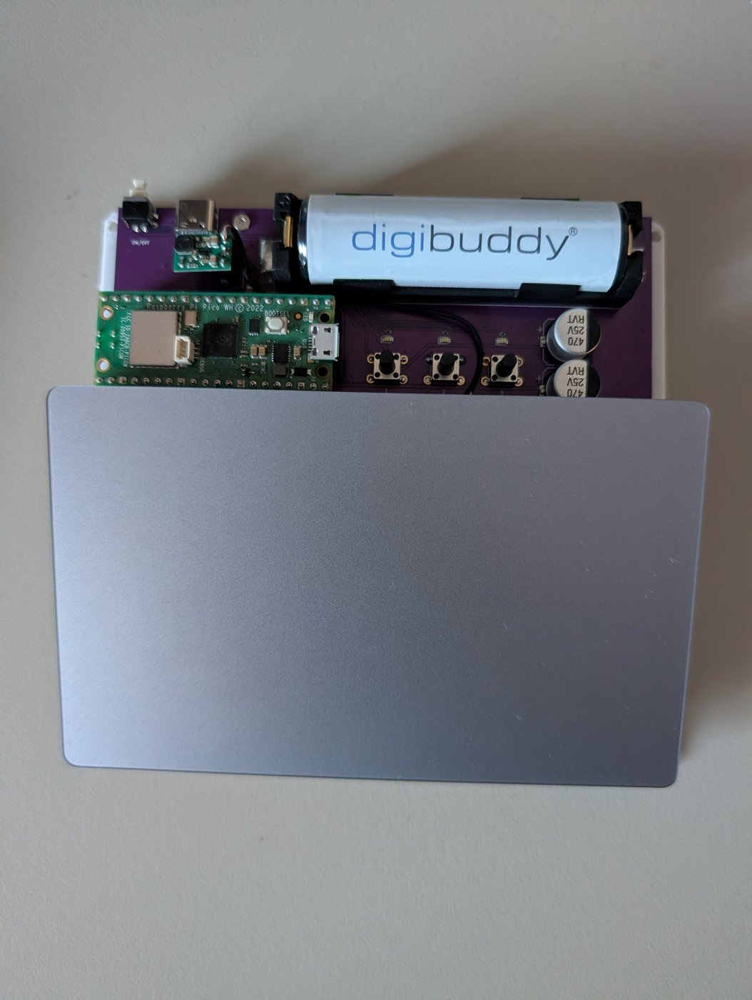
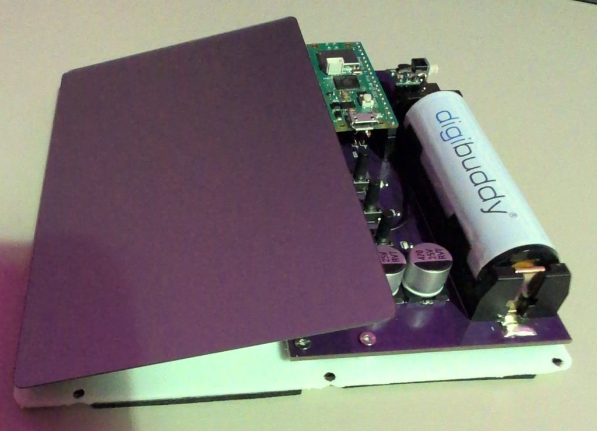

# A1708 Wireless Trackpad

**Turn the Force Touch trackpad of a MacBook Pro (A1708, 13" 2016–2017) into a standalone
USB / Bluetooth trackpad, with Mac-style 1:1 gestures.**

*[Leggi in italiano](README.it.md)*

<p align="center">
  
  
</p>

A Raspberry Pi Pico W talks to the trackpad over its native SPI protocol and presents it to the
computer as a **Windows Precision Touchpad** (PTP), over USB, classic Bluetooth or Bluetooth Low
Energy. Windows supports it natively. On macOS, which ignores third-party PTP devices, a small menu-bar app
([macos-trackpad-companion](https://github.com/mathias-sm/macos-trackpad-companion), patched for
this project) turns the raw touches into real macOS gestures: desktop swipes, Mission Control,
pinch, rotate and smooth scrolling that follow the fingers 1:1.

## Features

- **Original Apple hardware**: same glass, same Force Touch click with haptic feedback (generated
  by the trackpad itself).
- **Three connections**: USB-C cable, classic Bluetooth, or **Bluetooth Low Energy** with the
  standard Battery Service, so the battery level shows up in the macOS battery widget and in Windows
  settings.
- **Three paired computers** with one-press switching (like Logitech Easy-Switch), each with its
  own white LED.
- **18650 Li-ion battery** with USB-C charging, a power button, battery indication on the LEDs,
  power saving and an automatic rest mode.
- **Mac-like feel on macOS**: the companion patch uses the *exact* pointer and scroll
  acceleration curves of a MacBook's built-in trackpad, read from macOS itself.
- **Robust firmware**: message validation as in the Linux `applespi` driver, filtering of the
  touch glitches the trackpad produces while vibrating, de-bounced clicks.
- **Firmware updates through the USB-C port** with the case closed: hold buttons 1 and 3 while
  plugging in the cable.
- **All-in-one PCB** (KiCad, ready for JLCPCB assembly) and a **3D-printable wedge case**.

## How it works

```
 A1708 trackpad ──SPI (4 MHz) + 3.3 V / 5 V / 12 V──▶  all-in-one board
                                                         ├─ Raspberry Pi Pico W (firmware)
                                                         ├─ TP4056 charger + 18650 cell
                                                         ├─ MT3608 boost 5 V
                                                         └─ Pololu U3V16F12 boost 12 V (haptics)
        │
        ├─ USB HID ─────────────┐
        ├─ Bluetooth Classic ───┼──▶ Windows: native Precision Touchpad
        └─ Bluetooth LE (HOGP) ─┘    macOS:  Trackpad Companion app ──▶ native gestures
```

## Repository layout

| Folder | Contents |
|---|---|
| [`firmware/`](firmware) | Pico W firmware (C, pico-sdk, TinyUSB, BTstack) and prebuilt `.uf2` files |
| [`hardware/pcb/`](hardware/pcb) | KiCad board, Gerbers, BOM and placement files for JLCPCB |
| [`hardware/case/`](hardware/case) | STL files of the case and their Python source |
| [`macos-companion/`](macos-companion) | Patch for macos-trackpad-companion and a build script |
| [`docs/`](docs) | Build guide, firmware manual, macOS setup, SPI protocol notes |

## Getting started

1. **Read the [hardware guide](docs/en/hardware.md)**: parts list, PCB ordering and the two small
   hand modifications the current board needs.
2. **Flash the firmware**: copy `firmware/prebuilt/trackpad-a1708_pico_w.uf2` to the Pico W
   ([firmware manual](docs/en/firmware.md)).
3. **Print and assemble the case** ([assembly guide](docs/en/assembly.md)).
4. **Pair it**: hold button 1 for 3 seconds and look for "Trackpad A1708" in the Bluetooth settings.
5. **On a Mac**, build and install the companion app ([macOS guide](docs/en/macos.md)).

Documentation: [hardware](docs/en/hardware.md) · [assembly](docs/en/assembly.md) ·
[firmware](docs/en/firmware.md) · [macOS](docs/en/macos.md) · [SPI protocol](docs/en/protocol.md)

## Status and known limitations

This is a working personal build, shared as is. Things worth knowing:

- **Board revision v2 needs two hand modifications**: a wire that feeds the 12 V converter from the
  battery instead of the 5 V rail (without it, clicks are unreliable), and two wires for USB data.
  Both are described with pictures in the hardware guide.
- **Battery life** is roughly 20 hours of continuous use and about 30 hours left on idle with a
  3000 mAh cell (measured: ~86 mA in use, ~49 mA idle, ~38 mA in rest mode at 5 V). The Pico W
  and its radio set the floor; switch it off with the button when you are done.
- **Tested on**: macOS 27 (USB, classic Bluetooth, BLE) and Windows (USB and classic Bluetooth).
  BLE on Windows should work but has not been tested yet.
- **Pico W (RP2040)** is the tested board. A build for the Pico 2 W is provided, but the latest
  firmware has not been tested on it.
- On macOS, "shake mouse pointer to locate" does not trigger, because the pointer is moved by the
  companion app with synthetic events.
- The USB IDs are the pid.codes test pair `1209:0001`, fine for personal use. If you make and
  distribute devices, get your own.
- Code comments and some drawings are in Italian; the documentation is in English and Italian.

## Credits

- The SPI protocol and message format come from the Linux
  [`applespi`](https://github.com/torvalds/linux/blob/master/drivers/input/keyboard/applespi.c)
  driver, plus logic-analyser captures of a real MacBook.
- [macos-trackpad-companion](https://github.com/mathias-sm/macos-trackpad-companion) by its authors
  (MIT OR Apache-2.0): the macOS gesture engine this project builds on.
- The macOS 27 Dock-swipe event layout follows the work of
  [Mac Mouse Fix](https://github.com/noah-nuebling/mac-mouse-fix) and OpenLogi.
- Raspberry Pi [pico-sdk](https://github.com/raspberrypi/pico-sdk),
  [TinyUSB](https://github.com/hathach/tinyusb), [BTstack](https://github.com/bluekitchen/btstack).

## License

Firmware, hardware design files, case and documentation: **GNU GPL v3.0** (see [LICENSE](LICENSE)).

Exceptions:
- The companion patch in [`macos-companion/`](macos-companion) uses the upstream license,
  **MIT OR Apache-2.0**, so it can be merged back upstream.
- Third-party libraries keep their own licenses: pico-sdk (BSD-3-Clause), TinyUSB (MIT) and BTstack.
  BTstack is free for non-commercial use; on Raspberry Pi Pico W and Pico 2 W it is also covered by
  Raspberry Pi's licence agreement with BlueKitchen. Check its terms before any commercial use.

Author: **valMauro**
