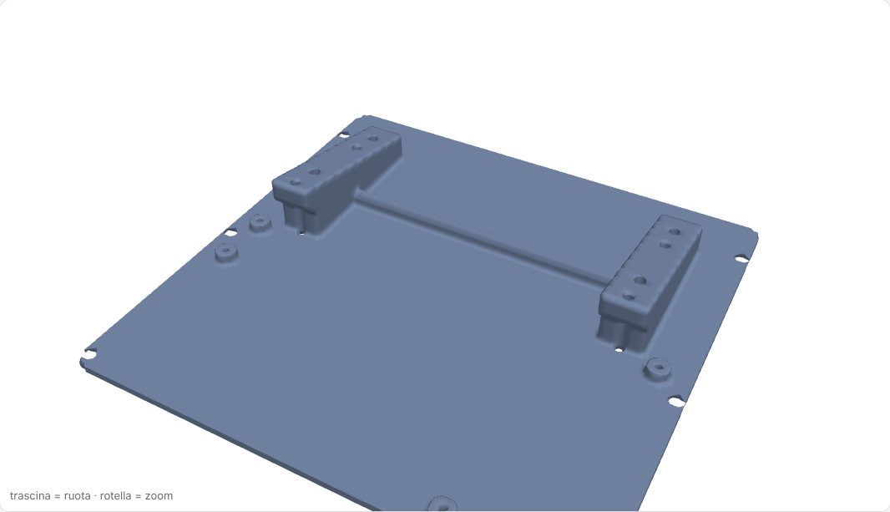

# Case and assembly

*[Italiano](../it/assembly.md)*



A wedge case, **138.9 × 135.2 mm**, 35 mm high at the back and 8 mm at the front (11.3°), made
of two printed parts. The glass sits ~0.5 mm below the top surface, with a chamfered edge, as on
a MacBook.

| File | What |
|---|---|
| [`hardware/case/shell.stl`](../../hardware/case/shell.stl) | top shell, already oriented (the sloped top face lies on the bed) |
| [`hardware/case/base.stl`](../../hardware/case/base.stl) | base plate with the trackpad supports, printed flat |
| [`hardware/case/source/`](../../hardware/case/source) | Python source (signed distance fields + marching cubes) |

You can also leave the shell out and use only the base: the board stays visible behind the
trackpad. The base is the important part, because it holds the trackpad rigidly.

## Printing

- **PLA or PLA+** (stiffer than PETG, so the trackpad feels more solid); PETG only if it will sit in
  the sun.
- 0.2 mm layers, **no supports** (overhangs are already chamfered).
- `shell.stl`: 4 perimeters, 25 % infill.
- `base.stl`: 5 perimeters, **50 % infill** (gyroid or grid). The trackpad supports must be as
  hard as a MacBook's chassis.

## What is in the parts

**Shell**
- The trackpad opening with 0.8 mm clearance per side. The glass must not touch anything, or
  Force Touch clicks stop working.
- 3 flexible button tabs on the shelf: each one pushes a 12 mm button on the board.
- 3 small tubes above the LEDs: insert 2–3 cm of clear 1.75 mm filament as light pipes.
- An opening at the back for the USB-C plug and the power button.
- 6 bosses for the base screws.

**Base**
- 4 standoffs (3.2 mm) for the board, M2 screws.
- 2 supports, 12 mm wide, for the metal brackets at the ends of the trackpad. Each stud on the
  trackpad drops into a round 3 mm pocket that centres it.
- 6 original **Torx T5** screws from below (3 front rows of studs), with an 8 mm access hole under
  each one for the screwdriver. The rear row only sits in its pockets.
- A cross brace between the supports, and 6 recesses for 10 mm rubber feet. Two of them sit right
  under the trackpad supports, so the finger pressure goes straight to the table.

**Rev 3 (this version):** 1 mm less plastic under the trackpad screw heads (1.4 mm instead of
2.4 mm). With rev 2 the original screws barely reached the threads of the studs. If you
printed an older base, counter-bore each screw hole from below with a 4–5 mm drill bit, about
1 mm deep.

## Hardware

- 6 × M2.5 × 10 mm self-tapping countersunk screws (base → shell)
- 4 × M2 × 6 mm self-tapping screws (board → standoffs)
- 6 of the trackpad's original Torx T5 screws, and a T5 screwdriver at least 6 cm long
- 6 rubber feet, 10 mm, hard rubber or thin silicone (not soft foam)

## Assembly

1. **Board**: screw it onto the 4 standoffs, USB-C towards the back edge.
2. **Flex cable**: plug it into J1 so that it leaves the connector **towards the "FLAT" mark**
   (towards the front). The plug also fits the wrong way round, so double-check.
3. **Half twist**: the trackpad's flex plug naturally faces up, while J1 faces up too. Give the
   flex **one gentle half twist** over 5–6 cm, close to the connector, without creasing it. Above
   J1 there are 13–14 mm of free height under the trackpad. Lay the extra flex in a soft loop in the
   free space in front of the board.
4. **Trackpad, "like a book"**: hold the trackpad upright on its rear edge, plug the flex, then
   lower it onto the supports. Glass up, haptic motor (copper) towards the front, every stud in its
   pocket. Screw the 6 T5 screws from below: firm, but stop as soon as you feel resistance (it is
   plastic, and the trackpad threads are tiny).
5. **Shell**: lower it over everything. The glass goes into the opening and ends up ~0.5 mm below
   the edge. Screw the 6 M2.5 screws from below.
6. **Feet**: stick the rubber feet into their recesses.

Do not hold the trackpad with soft double-sided tape. Force Touch measures the click through the
flexing of the trackpad's brackets: on a soft mount the click becomes mushy and uneven, and the
vibration loses strength.

## Rebuilding the STL files

```
cd hardware/case/source
pip install numpy scikit-image
python3 scocca.py                  # prints the main dimensions
python3 tools.py export 0.35 fondo # base  -> out/fondo.stl
python3 tools.py export 0.36 guscio # shell -> out/guscio.stl
python3 tools.py viewer             # 3D preview -> out/scocca-3d.html
```

All dimensions are at the top of `scocca.py` (variables and comments in Italian: `fondo` = base,
`guscio` = shell).
