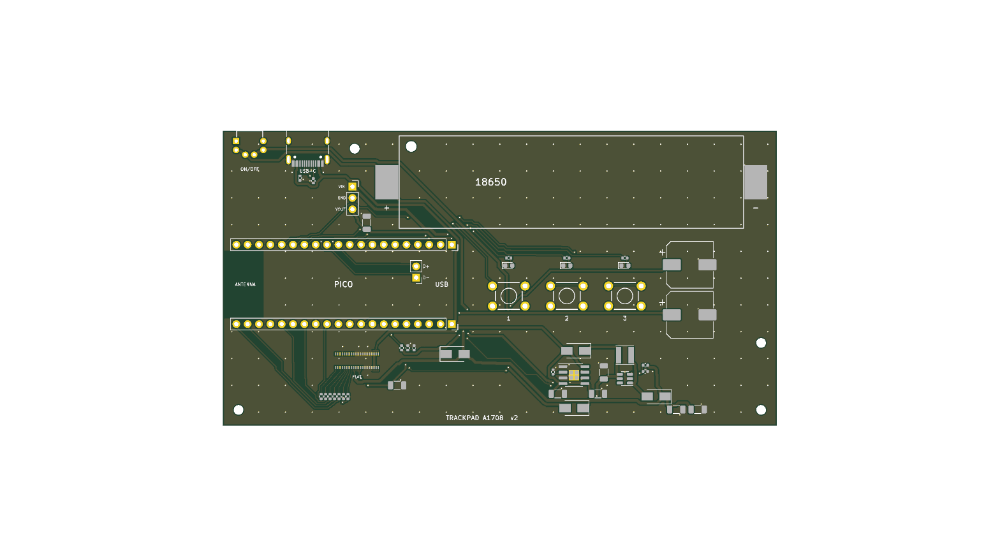
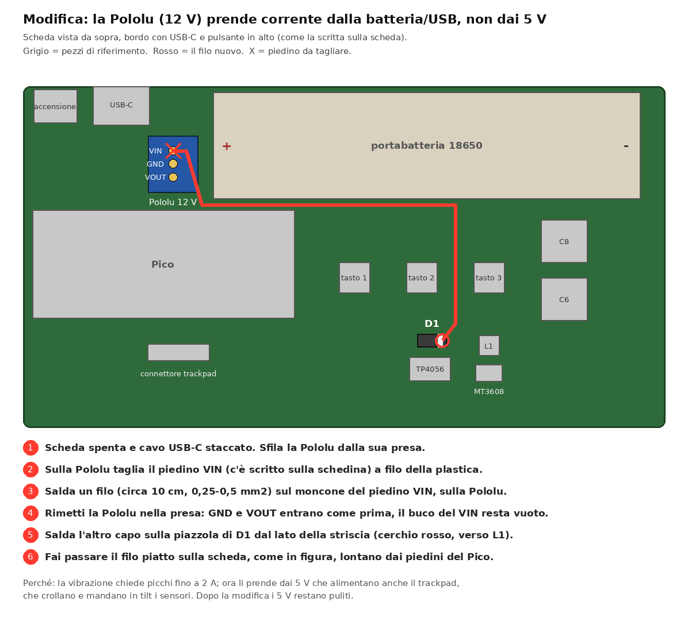
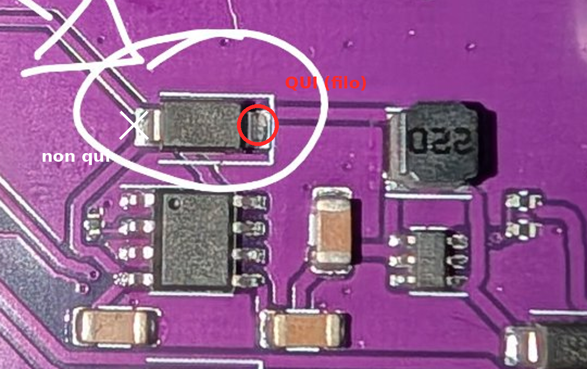
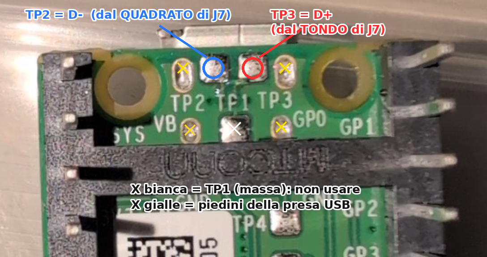

# Hardware guide

*[Italiano](../it/hardware.md)*

## The trackpad

The **A1708** trackpad comes from the MacBook Pro 13" 2016–2017 without Touch Bar
(MacBookPro13,1 / 14,1). It talks SPI and exposes everything on a 50-pin Hirose **DF40**
board-to-board plug at the end of its flex cable. You need the trackpad **with its original flex
cable** (the one that goes to the logic board) and its Torx T5 screws.

The trackpad needs:

| Rail | Used for | Source on this board |
|---|---|---|
| 3.3 V (S0 and S4) | logic, touch sensor | Pico W `3V3 OUT` (+470 µF) |
| 5 V | internal circuits | MT3608 boost, 5.1 V |
| 12 V ("PPVIN", 8 pins) | haptic actuator | Pololu U3V16F12 boost (+470 µF) |

Signals used: `SPI CLK/MOSI/MISO/CS`, `IF_EN` (interface enable), `LID` (must be **high**,
"lid open": with LID low the trackpad ignores fingers and does not vibrate). `INT`, `PME`,
`THERM`, `SMBus` and `VIBE` are not needed. Each signal has a 330 Ω series resistor.

## The board (rev v2)



124 × 66 mm, 2 layers, KiCad files in [`hardware/pcb/`](../../hardware/pcb).

- **Back edge**: USB-C (charging + USB data) and a self-locking power button.
- **Battery holder** for one 18650 cell, assembled by JLCPCB.
- **Raspberry Pi Pico W** in two 20-pin sockets, lying flat, antenna towards the left edge
  (keep-out zone, no copper).
- **Three tall buttons (12 mm) and three white LEDs** in front of the Pico: they come out of the
  case shelf behind the trackpad.
- **Front area (under the trackpad)**: only low parts. These are the DF40 connector, series resistors, the TP4056
  charger, the MT3608 boost and the OR diodes.
- **Socket for the Pololu U3V16F12** 12 V boost module.

### Power path

```
USB-C VBUS ─┬─▶ TP4056 ─▶ 18650 (B+) ─▶ power button ─▶ D2 ─┐
            └──────────────────────────────────────▶ D1 ────┴─▶ NODE ─▶ MT3608 ─▶ 5.1 V ─┬─▶ D3 ─▶ Pico VSYS
                                                                    │                    └─▶ trackpad 5 V
                                                                    └─▶ Pololu 12 V ─▶ trackpad PPVIN   (after mod 1)
```

With the cable plugged in, everything runs from USB through D1, whatever the button says, and the
TP4056 charges the cell (0.58 A). Without the cable, the button connects the cell.
`CHRG` → GP26 and `STDBY` → GP27 tell the firmware about charging; a 100k/100k divider on B+ → GP28
measures the battery.

### Pico W pin map

| Function | GPIO | Pico pin |
|---|---|---|
| SPI MISO / CS / SCK / MOSI | GP16 / GP17 / GP18 / GP19 | 21 / 22 / 24 / 25 |
| Trackpad IF_EN | GP20 | 26 |
| Trackpad INT (not used) | GP21 | 27 |
| Trackpad LID | GP22 | 29 |
| Buttons 1 / 2 / 3 (to GND) | GP10 / GP11 / GP12 | 14 / 15 / 16 |
| LEDs 1 / 2 / 3 | GP6 / GP7 / GP8 | 9 / 10 / 11 |
| Charger CHRG / STDBY | GP26 / GP27 | 31 / 32 |
| Battery ÷ 2 | GP28 (ADC2) | 34 |
| Force Bluetooth with cable (to GND at boot, optional) | GP15 | 20 |

## Parts

### Assembled by JLCPCB

`BOM-JLCPCB.csv` and `CPL-JLCPCB.csv` in [`hardware/pcb/`](../../hardware/pcb) (rotations already corrected for
JLC). Main parts: DF40C-50DS-0.4V (C424646), TP4056 (C16581), MT3608 (C84817) with a 22 µH
inductor, SS14/SS34 diodes, 2 × 470 µF 25 V, USB-C 16P, PB-22E77 self-locking switch, Pico sockets,
3 tall tact switches, 3 LEDs, BH-18650-B5BA008 battery holder (C5371777).

### Added by hand

| Part | Notes |
|---|---|
| Raspberry Pi Pico **WH** (Pico W with headers) | Pico W (RP2040) is the tested board |
| Pololu **U3V16F12** 12 V step-up + 3-pin header | goes in the J6 socket |
| One **18650** Li-ion cell | use a **protected** cell: the board has no protection IC. 3000–3500 mAh |
| A1708 trackpad with its flex cable and Torx T5 screws | |
| Two short wires for mod 1 and mod 2 | see below |

## Ordering the PCB at JLCPCB

1. Upload `gerber-trackpad-tutto.zip`. Settings: 2 layers, 1.6 mm, **ENIG** finish (needed by the
   fine-pitch DF40 connector), everything else default. Minimum quantity is 5.
2. Enable **PCB Assembly**, Standard, top side, quantity 2. Upload the BOM and CPL.
3. **Not assembled** (leave them out): J7 (two pads for the USB wires), mounting holes.
4. Check the placement preview:
   - the Pico sockets sit horizontally over their rows of holes;
   - the power button sticks out of the back edge next to the USB-C;
   - the battery holder's "+" faces the USB-C;
   - the pin-1 dots: TP4056 top left, MT3608 bottom right;
   - diode stripes: D1, D2 and D4 on the right, D3 on the left;
   - on C6 and C8 the "+" is on the left.
5. **Battery holder BT1**: its footprint has no holes for the plastic locating pegs. When JLC asks,
   tell them to **cut the pegs**: the holder is held by its SMD pads.

## Required modifications (rev v2)

### Mod 1: 12 V converter fed from the battery, not from 5 V (important)

On rev v2 the Pololu takes its input from the 5 V rail. That is the same rail that powers the
trackpad's 5 V pins. When the actuator fires, the Pololu draws up to 2 A, the MT3608 cannot keep
up, and the 5 V rail collapses. The trackpad then sends garbage for ~100 ms: phantom fingers,
double clicks, a one-finger click read as a right click, and a doubled vibration.

**Fix:** feed the Pololu's VIN from `NODE` (battery or USB, before the MT3608):

1. Board off, cable unplugged. Remove the Pololu from its socket.
2. Cut the Pololu's **VIN** pin flush with the plastic spacer.
3. Solder a wire (~10 cm, 0.25–0.5 mm²) to the VIN stub.
4. Put the Pololu back: GND and VOUT go in the socket, the VIN hole stays empty.
5. Solder the other end to **D1's cathode pad** (the striped side, towards the inductor L1).




After this mod there were zero phantom fingers in hundreds of clicks. The next board revision should route Pololu VIN to `NODE`.

### Mod 2: USB data to the Pico

The USB-C data lines end on the **J7** pads under the Pico. Solder two short wires (4–5 cm, keep
some slack to lift the Pico from its sockets, twist them together):

- J7 **square** pad (D−) → Pico **TP2**
- J7 **round** pad (D+) → Pico **TP3**

TP2 and TP3 are the two small square pads right under the micro-USB connector on the back of the
Pico. TP1 (ground) is the one below them.



Never plug the Pico's micro-USB and the board's USB-C at the same time once these wires are
in place.

## The DF40 connector orientation

The DF40 is **not polarised**: the plug fits both ways, but only one is right. The flex must leave
J1 **towards the "FLAT" mark** on the silkscreen (towards the front, away from the battery). On the
MacBook the logic board sits upside down above the trackpad. Here the board faces up, so the flex
needs **one half twist**. Under the rear of the trackpad the case has 13–14 mm of height, enough
for a gentle twist ([assembly guide](assembly.md)).

## Power consumption (measured at the USB input, 5 V, BLE)

| State | Current |
|---|---|
| In use, moving | ~86 mA |
| Moving and clicking | ~113 mA |
| Idle (no fingers) | ~49 mA |
| Rest mode (after 15 min, wake with a button) | ~38 mA |
| 12 V converter, idle | ~2 mA |

## Lessons learned

- **The haptic actuator needs a stiff supply.** Feeding it through a cascade of two boost
  converters makes the touch and force sensors go haywire on every click (see mod 1).
- **CS timing**: the trackpad needs ~35–50 µs between CS low and the first clock edge, otherwise
  the data is shifted.
- **LID must be high**, or the trackpad ignores fingers.
- **Mount the trackpad rigidly.** Force Touch measures the click from the flexing of its brackets;
  soft double-sided tape makes clicks mushy and uneven.
- Clicking is detected, and the haptic pulse played, by the trackpad itself: the host only has to
  provide 12 V.
