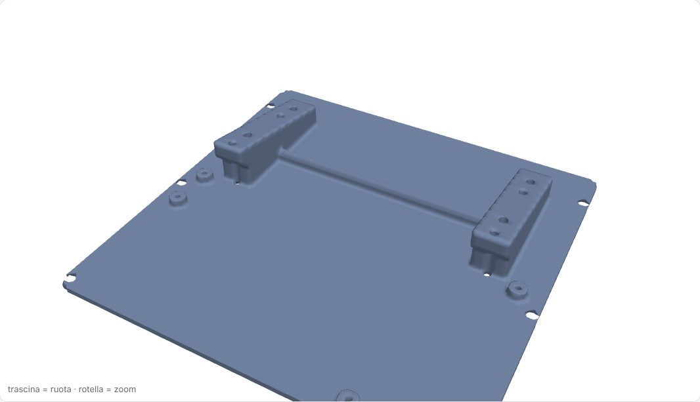

# Scocca e montaggio

*[English](../en/assembly.md)*



Una scocca a cuneo, **138,9 × 135,2 mm**, alta 35 mm dietro e 8 mm davanti (11,3°), in due pezzi
stampati. Il vetro sta ~0,5 mm sotto la superficie, con il bordo smussato, come su un MacBook.

| File | Cosa |
|---|---|
| [`hardware/case/shell.stl`](../../hardware/case/shell.stl) | guscio superiore, già orientato (la faccia superiore inclinata appoggia sul piatto) |
| [`hardware/case/base.stl`](../../hardware/case/base.stl) | fondo con i supporti del trackpad, stampato in piano |
| [`hardware/case/source/`](../../hardware/case/source) | sorgente Python (campi di distanza + marching cubes) |

Puoi anche non mettere il guscio e usare solo il fondo: la scheda resta a vista dietro il
trackpad. Il fondo è la parte importante, perché tiene il trackpad in modo rigido.

## Stampa

- **PLA o PLA+** (più rigido del PETG, il trackpad risulta più solido); PETG solo se starà al sole.
- Strati da 0,2 mm, **senza supporti** (gli sbalzi sono già smussati).
- `shell.stl`: 4 perimetri, riempimento 25 %.
- `base.stl`: 5 perimetri, **riempimento 50 %** (gyroid o griglia). I supporti del trackpad devono
  essere duri come il telaio di un MacBook.

## Cosa c'è nei pezzi

**Guscio**
- L'apertura per il trackpad con 0,8 mm di gioco per lato. Il vetro non deve toccare niente,
  altrimenti i clic Force Touch smettono di funzionare.
- 3 linguette flessibili sul ripiano: ognuna preme un tasto da 12 mm della scheda.
- 3 tubetti sopra i LED: infila 2–3 cm di filamento trasparente da 1,75 mm come guida luce.
- Un'apertura dietro per la spina USB-C e il pulsante di accensione.
- 6 torrette per le viti del fondo.

**Fondo**
- 4 distanziali (3,2 mm) per la scheda, viti M2.
- 2 supporti larghi 12 mm per le staffe metalliche alle estremità del trackpad. Ogni perno del
  trackpad entra in una sede tonda da 3 mm che lo centra.
- 6 viti **Torx T5** originali da sotto (le 3 file di perni davanti), con un foro da 8 mm sotto
  ognuna per il cacciavite. La fila posteriore resta solo appoggiata nelle sue sedi.
- Una traversa tra i supporti e 6 incavi per piedini in gomma da 10 mm. Due stanno proprio sotto i
  supporti del trackpad, così la pressione del dito scarica dritta sul tavolo.

**Rev 3 (questa versione):** 1 mm di plastica in meno sotto le teste delle viti del trackpad
(1,4 mm invece di 2,4 mm). Con la rev 2 le viti originali arrivavano appena ai filetti dei perni.
Se hai stampato un fondo vecchio, allarga ogni foro vite da sotto con una punta da 4–5 mm, per
circa 1 mm di profondità.

## Viteria

- 6 viti autofilettanti a testa svasata M2,5 × 10 mm (fondo → guscio)
- 4 viti autofilettanti M2 × 6 mm (scheda → distanziali)
- 6 viti Torx T5 originali del trackpad e un cacciavite T5 lungo almeno 6 cm
- 6 piedini in gomma da 10 mm, gomma dura o silicone sottile (non spugna morbida)

## Montaggio

1. **Scheda**: avvitala sui 4 distanziali, USB-C verso il bordo posteriore.
2. **Cavo flat**: inseriscilo in J1 in modo che esca dal connettore **verso la scritta "FLAT"**
   (verso il davanti). La spina entra anche al contrario, quindi ricontrolla.
3. **Mezzo giro**: la spina del flat del trackpad guarda naturalmente in su, e anche J1 guarda in
   su. Fai fare al flat **un mezzo giro morbido** su 5–6 cm, vicino al connettore, senza piegarlo
   a spigolo. Sopra J1 ci sono 13–14 mm liberi sotto il trackpad. Il flat in più si sistema in
   un'ansa morbida nello spazio libero davanti alla scheda.
4. **Trackpad, "come un libro"**: tieni il trackpad dritto sul suo bordo posteriore, collega il
   flat, poi abbassalo sui supporti. Vetro in su, motore della vibrazione (rame) verso il davanti,
   ogni perno nella sua sede. Avvita le 6 viti T5 da sotto: strette, ma fermati appena senti
   resistenza (è plastica, e i filetti del trackpad sono piccolissimi).
5. **Guscio**: calalo sopra tutto. Il vetro entra nell'apertura e resta ~0,5 mm sotto il bordo.
   Avvita le 6 viti M2,5 da sotto.
6. **Piedini**: incolla i piedini in gomma nei loro incavi.

Non fissare il trackpad con biadesivo morbido. Il Force Touch misura il clic dalla flessione delle
staffe del trackpad: su un fissaggio morbido il clic diventa molle e irregolare, e la vibrazione
perde forza.

## Rigenerare i file STL

```
cd hardware/case/source
pip install numpy scikit-image
python3 scocca.py                   # stampa le misure principali
python3 tools.py export 0.35 fondo  # fondo  -> out/fondo.stl
python3 tools.py export 0.36 guscio # guscio -> out/guscio.stl
python3 tools.py viewer             # anteprima 3D -> out/scocca-3d.html
```

Tutte le misure sono in cima a `scocca.py`.
