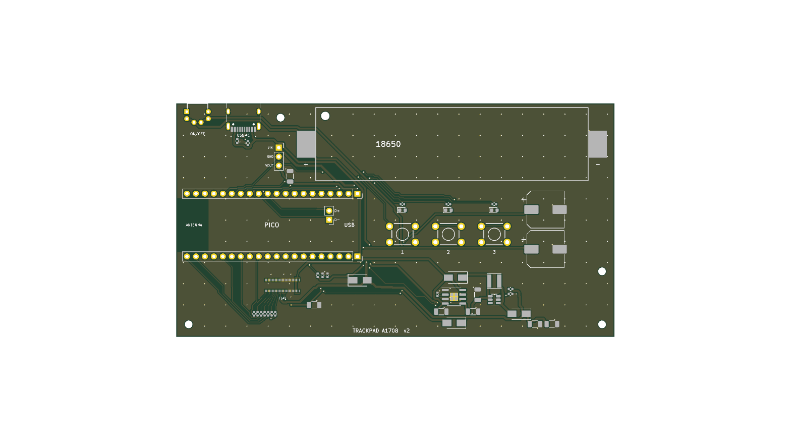
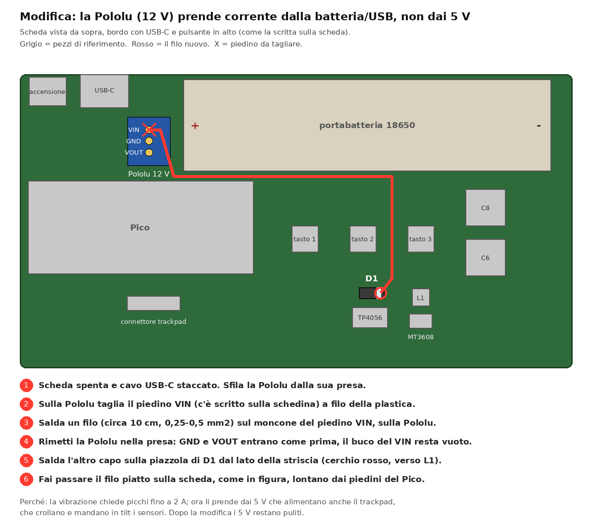
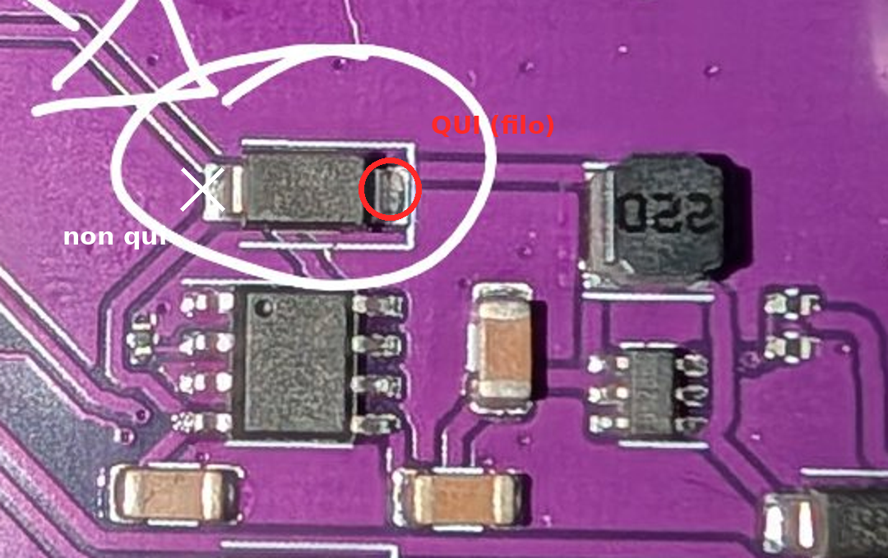
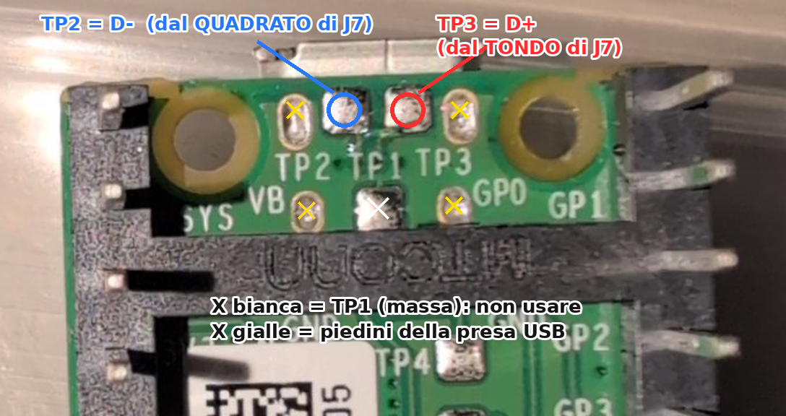

# Guida hardware

*[English](../en/hardware.md)*

## Il trackpad

Il trackpad **A1708** viene dal MacBook Pro 13" 2016–2017 senza Touch Bar
(MacBookPro13,1 / 14,1). Parla SPI e porta tutto su un connettore scheda-scheda Hirose **DF40** da
50 pin in fondo al suo cavo flat. Serve il trackpad **con il suo cavo flat originale** (quello che
va alla scheda logica) e le sue viti Torx T5.

Il trackpad vuole:

| Alimentazione | A cosa serve | Da dove arriva su questa scheda |
|---|---|---|
| 3,3 V (S0 e S4) | logica, sensore touch | `3V3 OUT` del Pico W (+470 µF) |
| 5 V | circuiti interni | elevatore MT3608, 5,1 V |
| 12 V ("PPVIN", 8 pin) | attuatore della vibrazione | elevatore Pololu U3V16F12 (+470 µF) |

Segnali usati: `SPI CLK/MOSI/MISO/CS`, `IF_EN` (abilita l'interfaccia), `LID` (deve stare **alto**,
"coperchio aperto": con LID basso il trackpad ignora le dita e non vibra). `INT`, `PME`, `THERM`,
`SMBus` e `VIBE` non servono. Ogni segnale ha una resistenza in serie da 330 Ω.

## La scheda (rev v2)



124 × 66 mm, 2 strati, file KiCad in [`hardware/pcb/`](../../hardware/pcb).

- **Bordo posteriore**: USB-C (ricarica + dati USB) e pulsante di accensione a ritenuta.
- **Portabatteria** per una cella 18650, montato da JLCPCB.
- **Raspberry Pi Pico W** su due zoccoli da 20 pin, sdraiato, antenna verso il bordo sinistro
  (zona senza rame).
- **Tre tasti alti (12 mm) e tre LED bianchi** davanti al Pico: escono dal ripiano della scocca
  dietro il trackpad.
- **Zona davanti (sotto il trackpad)**: solo componenti bassi. Ci sono il connettore DF40, le
  resistenze in serie, il caricatore TP4056, l'elevatore MT3608 e i diodi OR.
- **Zoccolo per il modulo Pololu U3V16F12** da 12 V.

### Percorso dell'alimentazione

```
USB-C VBUS ─┬─▶ TP4056 ─▶ 18650 (B+) ─▶ pulsante ─▶ D2 ─┐
            └──────────────────────────────────▶ D1 ────┴─▶ NODE ─▶ MT3608 ─▶ 5,1 V ─┬─▶ D3 ─▶ VSYS del Pico
                                                                │                    └─▶ 5 V del trackpad
                                                                └─▶ Pololu 12 V ─▶ PPVIN del trackpad   (dopo la modifica 1)
```

Col cavo collegato tutto va dalla USB attraverso D1, qualunque sia la posizione del pulsante, e il
TP4056 carica la cella (0,58 A). Senza cavo, il pulsante collega la cella.
`CHRG` → GP26 e `STDBY` → GP27 dicono al firmware lo stato della ricarica; un partitore 100k/100k
su B+ → GP28 misura la batteria.

### Pin del Pico W

| Funzione | GPIO | Pin del Pico |
|---|---|---|
| SPI MISO / CS / SCK / MOSI | GP16 / GP17 / GP18 / GP19 | 21 / 22 / 24 / 25 |
| IF_EN del trackpad | GP20 | 26 |
| INT del trackpad (non usato) | GP21 | 27 |
| LID del trackpad | GP22 | 29 |
| Tasti 1 / 2 / 3 (verso GND) | GP10 / GP11 / GP12 | 14 / 15 / 16 |
| LED 1 / 2 / 3 | GP6 / GP7 / GP8 | 9 / 10 / 11 |
| Caricatore CHRG / STDBY | GP26 / GP27 | 31 / 32 |
| Batteria ÷ 2 | GP28 (ADC2) | 34 |
| Forza il Bluetooth col cavo (a GND all'accensione, facoltativo) | GP15 | 20 |

## Componenti

### Montati da JLCPCB

`BOM-JLCPCB.csv` e `CPL-JLCPCB.csv` in [`hardware/pcb/`](../../hardware/pcb) (rotazioni già
corrette per JLC). Componenti principali: DF40C-50DS-0.4V (C424646), TP4056 (C16581), MT3608
(C84817) con induttanza da 22 µH, diodi SS14/SS34, 2 × 470 µF 25 V, USB-C 16P, interruttore a
ritenuta PB-22E77, zoccoli del Pico, 3 tasti alti, 3 LED, portabatteria BH-18650-B5BA008 (C5371777).

### Da aggiungere a mano

| Componente | Note |
|---|---|
| Raspberry Pi Pico **WH** (Pico W con i pin) | il Pico W (RP2040) è la scheda provata |
| Pololu **U3V16F12** 12 V step-up + pin da 3 | va nello zoccolo J6 |
| Una cella Li-ion **18650** | usa una cella **protetta**: la scheda non ha un integrato di protezione. 3000–3500 mAh |
| Trackpad A1708 con il cavo flat e le viti Torx T5 | |
| Due fili corti per le modifiche 1 e 2 | vedi sotto |

## Ordinare la scheda da JLCPCB

1. Carica `gerber-trackpad-tutto.zip`. Impostazioni: 2 strati, 1,6 mm, finitura **ENIG** (serve al
   connettore DF40 a passo fine), il resto di default. La quantità minima è 5.
2. Attiva **PCB Assembly**, Standard, lato top, quantità 2. Carica BOM e CPL.
3. **Da non montare** (escludili): J7 (due piazzole per i fili USB), fori di fissaggio.
4. Controlla l'anteprima del posizionamento:
   - gli zoccoli del Pico stanno orizzontali sulle loro file di fori;
   - il pulsante di accensione sporge dal bordo posteriore accanto alla USB-C;
   - il "+" del portabatteria è verso la USB-C;
   - i pallini del pin 1: TP4056 in alto a sinistra, MT3608 in basso a destra;
   - righe dei diodi: D1, D2 e D4 a destra, D3 a sinistra;
   - su C6 e C8 il "+" è a sinistra.
5. **Portabatteria BT1**: la sua impronta non ha i fori per i pioli di plastica. Quando JLC lo
   chiede, di' di **tagliare i pioli**: il portabatteria è tenuto dalle piazzole SMD.

## Modifiche necessarie (rev v2)

### Modifica 1: convertitore 12 V alimentato dalla batteria, non dai 5 V (importante)

Sulla rev v2 il Pololu prende l'ingresso dai 5 V. È la stessa linea che alimenta i pin 5 V del
trackpad. Quando l'attuatore vibra, il Pololu assorbe fino a 2 A, l'MT3608 non ce la fa e i 5 V
crollano. Il trackpad allora manda dati sbagliati per ~100 ms: dita fantasma, doppi clic, clic con
un dito letto come clic destro e vibrazione doppia.

**Soluzione:** alimenta il VIN del Pololu da `NODE` (batteria o USB, prima dell'MT3608):

1. Scheda spenta, cavo scollegato. Togli il Pololu dallo zoccolo.
2. Taglia il pin **VIN** del Pololu a filo del distanziale di plastica.
3. Salda un filo (~10 cm, 0,25–0,5 mm²) sul moncone di VIN.
4. Rimetti il Pololu: GND e VOUT vanno nello zoccolo, il foro di VIN resta vuoto.
5. Salda l'altro capo sulla **piazzola del catodo di D1** (il lato con la riga, verso
   l'induttanza L1).




Dopo questa modifica: zero dita fantasma su centinaia di clic. La prossima revisione della scheda
dovrebbe collegare il VIN del Pololu a `NODE`.

### Modifica 2: dati USB al Pico

Le linee dati della USB-C finiscono sulle piazzole **J7** sotto il Pico. Salda due fili corti
(4–5 cm, lascia un po' di gioco per poter sollevare il Pico dagli zoccoli, intrecciali tra loro):

- piazzola **quadrata** di J7 (D−) → **TP2** del Pico
- piazzola **tonda** di J7 (D+) → **TP3** del Pico

TP2 e TP3 sono le due piccole piazzole quadrate proprio sotto il connettore micro-USB, sul retro
del Pico. TP1 (massa) è quella sotto di loro.



Una volta montati questi fili, non collegare mai insieme la micro-USB del Pico e la USB-C della
scheda.

## Verso del connettore DF40

Il DF40 **non è polarizzato**: la spina entra in tutti e due i versi, ma solo uno è giusto. Il flat
deve uscire da J1 **verso la scritta "FLAT"** sulla serigrafia (verso il davanti, lontano dalla
batteria). Nel MacBook la scheda logica sta capovolta sopra il trackpad. Qui la scheda guarda in
su, quindi il flat deve fare **mezzo giro**. Sotto la parte posteriore del trackpad la scocca ha
13–14 mm di altezza, abbastanza per una torsione morbida ([guida al montaggio](assembly.md)).

## Consumi (misurati all'ingresso USB, 5 V, BLE)

| Stato | Corrente |
|---|---|
| In uso, muovendo | ~86 mA |
| Muovendo e cliccando | ~113 mA |
| Fermo (senza dita) | ~49 mA |
| Riposo (dopo 15 min, si sveglia con un tasto) | ~38 mA |
| Convertitore 12 V, a vuoto | ~2 mA |

## Cosa abbiamo imparato

- **L'attuatore della vibrazione vuole un'alimentazione solida.** Alimentarlo con due elevatori in
  cascata manda in tilt i sensori di tocco e di forza a ogni clic (vedi modifica 1).
- **Tempi del CS**: il trackpad vuole ~35–50 µs tra CS basso e il primo fronte di clock, altrimenti
  i dati arrivano sfasati.
- **LID deve stare alto**, altrimenti il trackpad ignora le dita.
- **Fissa il trackpad in modo rigido.** Il Force Touch misura il clic dalla flessione delle sue
  staffe: il biadesivo morbido rende i clic molli e irregolari.
- Il clic lo riconosce, e la vibrazione la genera, il trackpad stesso: basta dargli i 12 V.
